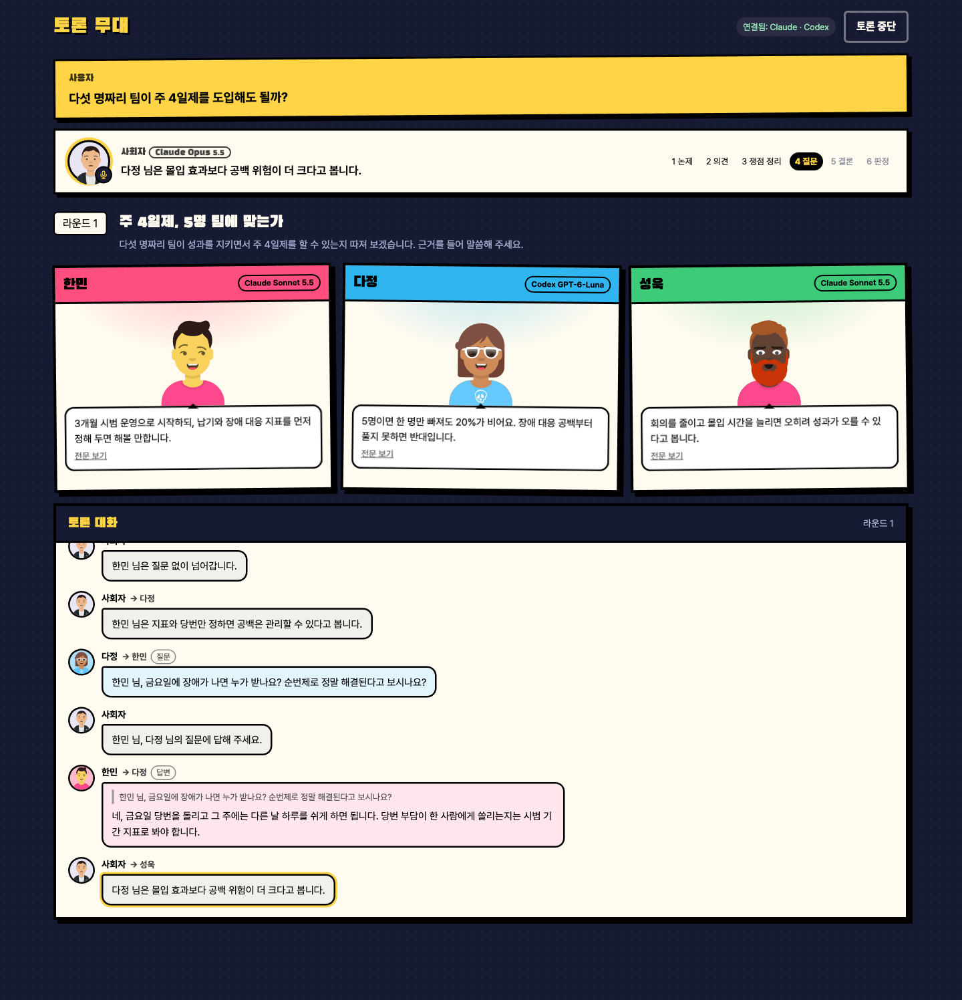
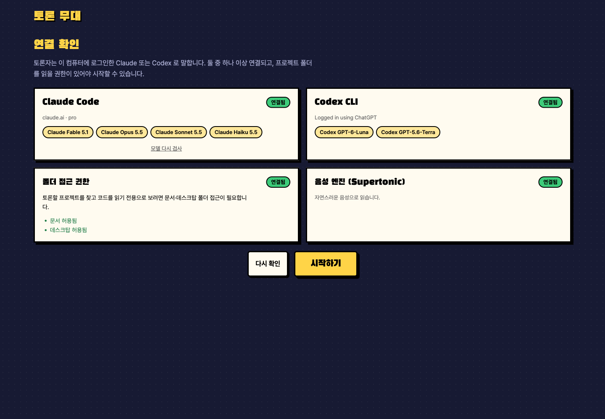
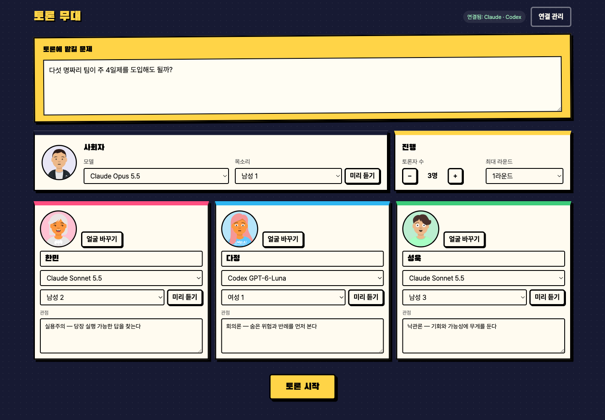
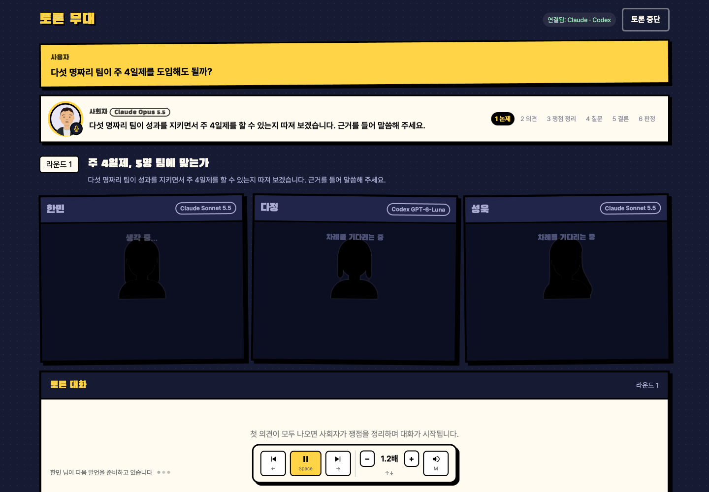
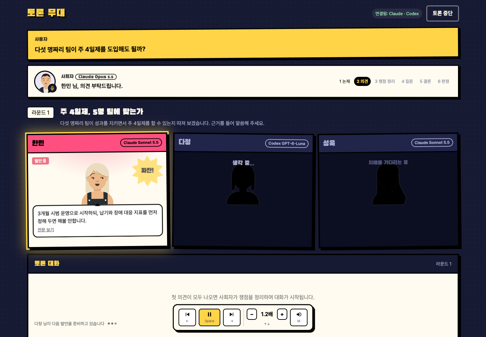
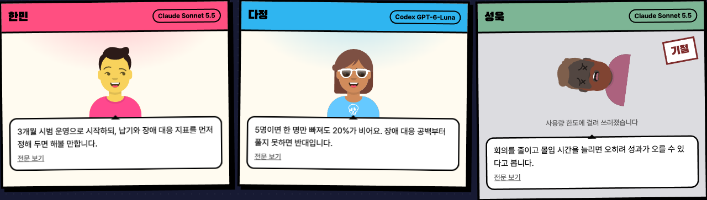
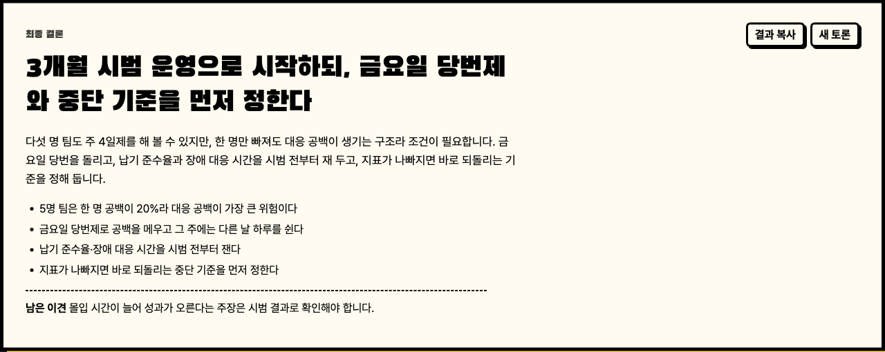

# 토론 무대

문제 하나를 던지면 AI 사회자가 논제를 세우고, AI 토론자들이 차례로 의견을 내고 서로 묻고 답한 뒤 결론을 내는 맥 앱입니다.
"우리 프로젝트 인증 구조 괜찮아?"처럼 코드에 대해 물으면 토론자들이 그 프로젝트 코드를 직접 읽고 토론합니다.



- 토론자는 **이 맥에 로그인한 Claude Code 또는 Codex** 로 말합니다. API 키를 쓰지 않아서 따로 과금되지 않고, 각자의 구독 사용량에서 차감됩니다.
- 사회자와 토론자마다 모델을 고를 수 있습니다. Claude Opus·Sonnet·Haiku와 Codex 모델을 섞어서 붙여도 됩니다.
- 발언은 사람마다 다른 목소리로 읽어 줍니다(로컬 음성 엔진 Supertonic). 읽는 동안 다음 발언을 미리 준비합니다.

## 설치

1. [Releases](https://github.com/hanminlim/ai-debate/releases) 에서 최신 `.dmg` 를 받아 `AI Debate` 를 Applications 로 옮깁니다.
2. Claude Code 와 Codex 중 하나 이상을 설치하고 로그인합니다.

   ```bash
   npm install -g @anthropic-ai/claude-code && claude auth login
   npm install -g @openai/codex && codex login
   ```

### 처음 열 때

서명하지 않은 앱이라 macOS 가 "확인되지 않은 개발자" 경고를 띄웁니다.
Applications 에서 앱을 **우클릭 → 열기 → 열기** 를 한 번 하면 그다음부터는 그냥 열립니다.
그래도 열리지 않으면 터미널에서 아래를 한 번 실행합니다.

```bash
xattr -dr com.apple.quarantine "/Applications/AI Debate.app"
```

## 쓰는 법

### 1. 연결 확인

앱을 열면 이 화면이 먼저 뜹니다. Claude Code·Codex 중 하나 이상이 연결되고 폴더 접근이 허용돼야 시작 버튼이 열립니다.
Claude 는 쓸 수 있는 모델을 실제로 짧게 불러 보고 되는 것만 보여 줍니다. 첫 확인에 몇 초 걸리고 결과는 저장해 두며, 다시 검사하려면 Claude 카드의 "모델 다시 검사"를 누릅니다(사용량을 조금 씁니다).



| 항목 | 필요한 것 | 없을 때 |
|---|---|---|
| Claude Code / Codex | 둘 중 하나 이상 설치·로그인 | 화면에 설치·로그인 명령이 나옵니다 |
| 폴더 접근 | 문서·데스크탑 폴더 읽기 허용 | "시스템 설정 열기"로 파일 및 폴더 권한을 켭니다 |
| 음성 엔진 (선택) | Python 3, 약 400MB 다운로드 | 시스템 음성으로 읽습니다. 화면에서 바로 설치할 수 있습니다 |

### 2. 문제와 출연진 정하기

토론할 문제를 적고 사회자·토론자의 모델, 목소리, 관점을 고릅니다. 토론자는 2~5명, 라운드는 최대 1~5회입니다.
토론자 얼굴은 "얼굴 바꾸기"로 다시 뽑을 수 있고, 사회자는 정장 차림 앵커로 고정돼 있습니다.



코드에 대해 토론하려면 문제에 프로젝트 이름이나 경로를 적으면 됩니다. 예: `xpert-creative-lab 의 인증 구조, 이대로 괜찮을까?`
앱이 `~/PycharmProjects`, `~/Documents/GitHub`, `~/projects` 같은 흔한 위치에서 git 프로젝트 **폴더 이름만** 모으고, 사회자가 그중 문제에 맞는 하나를 고릅니다.
고른 폴더는 화면 위 "대상 코드"에 표시됩니다.

### 3. 토론 보기

한 라운드는 이렇게 흘러갑니다.

1. **논제**: 사회자가 문제를 풀기 위한 논제를 세우고 소개합니다.
2. **의견**: 사회자가 한 명씩 지목합니다. 차례가 아닌 토론자는 불 꺼진 무대의 실루엣으로 기다리고, 지목되면 불이 켜지며 의견을 말합니다. 뒷사람은 앞사람 의견을 듣고 말합니다.
3. **쟁점 정리**: 사회자가 의견 차이를 정리합니다.
4. **질문**: 사회자가 토론자마다 다른 의견을 전하면, 그 토론자가 한 명을 골라 질문하고 상대가 바로 답합니다.
5. **결론**: 각자 이번 라운드의 결론을 말합니다. 처음과 입장이 바뀌면 "입장 변화" 도장이 찍힙니다.
6. **판정**: 사회자가 더 따질 쟁점이 남았으면 다음 라운드로, 아니면 최종 결론으로 갑니다.

| 생각 중 | 지목되면 불이 켜진다 |
|---|---|
|  |  |

첫 의견 뒤의 발언은 아래 "토론 대화" 창에 메신저처럼 쌓이고, 대화가 시작되면 화면이 그쪽으로 내려갑니다.

### 4. 리모컨과 단축키


| 키 | 동작 |
|---|---|
| → | 다음 발언으로 넘기기. 다음 발언이 아직 준비 중이면 로딩이 뜹니다 |
| ← | 이전 발언 다시 듣기 |
| Space | 일시정지 / 다시 재생 |
| ↑ / ↓ | 말하기 속도 0.1배씩 (0.5~2배, 말하는 도중에도 바로 바뀜) |
| M | 음소거 |

라운드를 마무리하는 사회자 정리와 최종 결론은 넘길 수 없습니다. 연타해도 라운드를 건너뛰지 않고, ←도 현재 라운드 안에서만 되돌아갑니다.

### 5. 기절

토론 중에 누군가의 구독 사용량이 바닥나면 그 사람은 무대에서 쓰러집니다. 토론자가 쓰러지면 나머지끼리 계속하고, 사회자가 쓰러지면 토론이 멈춥니다.



### 6. 결론과 결과 복사



"결과 복사"를 누르면 다른 AI 에 그대로 붙여 넣을 수 있는 프롬프트 형식으로 복사됩니다. 중간에 멈춘 토론도 거기까지의 내용을 복사할 수 있습니다.

```text
「다섯 명짜리 팀이 주 4일제를 도입해도 될까?」를 두고 AI 토론자 3명이 1라운드 논의한 결과, 다음 결론이 났다.

## 결론
3개월 시범 운영으로 시작하되, 금요일 당번제와 중단 기준을 먼저 정한다
...
## 핵심 근거
- 5명 팀은 한 명 공백이 20%라 대응 공백이 가장 큰 위험이다
...
## 논의 경과
### 라운드 1: 주 4일제, 5명 팀에 맞는가
- 한민(실용주의 — 당장 실행 가능한 답을 찾는다): 3개월 시범 운영으로 시작하되 … → 결론: …
- 다정 → 한민 질문: 금요일에 장애가 나면 누가 받나요? … / 답: …
- 사회자 정리: …
```

> 위 스크린샷은 README 용 예시 토론을 재현한 화면입니다.

## 안전장치

- **과금 경로 차단**: CLI 를 부를 때 환경변수를 비우고 HOME·PATH 같은 꼭 필요한 것만 넘깁니다. `ANTHROPIC_API_KEY`·`OPENAI_API_KEY`·`CODEX_API_KEY` 나 다른 제공자 설정이 있어도 구독 로그인으로만 호출합니다.
- **코드는 Claude 토론자만 읽습니다.** 고른 폴더 안만 읽기 전용(Read·Grep·Glob)으로 보고(`--restricted`), 폴더 밖 읽기는 거부되며 쓰기·명령 실행 도구는 아예 주지 않습니다.
- **Codex 토론자는 코드를 읽지 않습니다.** Codex 샌드박스는 디스크 읽기를 막지 못해서, 저장소 안에 심어 둔 지시에 끌려 폴더 밖 파일을 읽을 수 있기 때문입니다. 코드 토론에서 Codex 토론자는 다른 토론자가 인용한 내용을 보고 말합니다.
- **토큰 절약**: 코드는 근거가 필요한 의견·답변 단계에서만 열고, 사회자와 나머지 단계는 도구 없이 부릅니다. 프로젝트를 고를 때도 홈 경로 없이 폴더 이름만 보냅니다.
- **중단하면 바로 멈춥니다.** 실행 중인 CLI 프로세스를 끊고, 그 뒤 호출은 나가지 않습니다. 앱을 종료할 때도 남은 호출을 정리합니다.
- 각자의 CLAUDE.md·훅·플러그인·Codex 설정이 토론자에게 섞이지 않도록 꺼 두고 부릅니다.
- 음성 엔진은 이 맥 안(127.0.0.1)에서만 돌고, 응답이 Supertonic 인지 확인한 뒤에만 대본을 보냅니다. 설치 시 하위 의존성 버전을 고정합니다.

"결과 복사"는 토론 내용을 그대로 담습니다. 토론 대상 저장소에 이상한 지시문이 섞여 있을 수 있으니, 복사한 결론을 다른 에이전트에 넘길 때는 한 번 읽어 보고 넘기세요.

## 개발

필요한 것: Node.js 20 이상, Rust(rustup), Xcode Command Line Tools.

```bash
npm install
npm run app        # 개발 모드로 앱 실행
npm test           # JS 테스트 + Rust 테스트
npm run app:build  # .dmg 만들기 → src-tauri/target/release/bundle/dmg
```

실제 CLI 를 부르는 통합 테스트는 기본 실행에서 빠져 있습니다(구독 사용량을 조금 씁니다).

```bash
cargo test --manifest-path src-tauri/Cargo.toml -- --ignored
```

### 릴리즈

`src-tauri/tauri.conf.json` 의 `version` 을 올리고 같은 번호로 태그를 push 하면,
GitHub Actions 가 Apple Silicon·Intel 겸용(universal) `.dmg` 를 빌드해 Release 에 올립니다.

```bash
git tag v0.2.0
git push origin v0.2.0
```

### 구조

| 파일 | 역할 |
|---|---|
| `src-tauri/src/cli.rs` | `claude`·`codex` 실행, 인자, 취소, 사용량 한도 판별 |
| `src-tauri/src/env.rs` | 연결 확인(설치·로그인·폴더 권한), 쓸 수 있는 모델 확인 |
| `src-tauri/src/projects.rs` | 프로젝트 폴더 후보 목록(이름만) |
| `src-tauri/src/tts.rs` | Supertonic 설치·실행·음성 생성 |
| `src/engine.js` | 토론 진행. 발언을 대본 이벤트로 내보낸다 |
| `src/script.js` | 대본 이벤트를 화면 상태로 바꾸고, 결과를 프롬프트로 만든다 |
| `src/App.jsx` | 화면과 재생기(넘기기·이전·일시정지) |
| `src/Gate.jsx` · `src/Remote.jsx` | 연결 확인, 리모컨 |

## 라이선스 메모

- 음성: [Supertonic](https://github.com/supertone-inc/supertonic) — 코드 MIT, 모델 OpenRAIL-M
- 얼굴: [DiceBear](https://www.dicebear.com) avataaars — Pablo Stanley 디자인, 개인·상업 사용 무료
